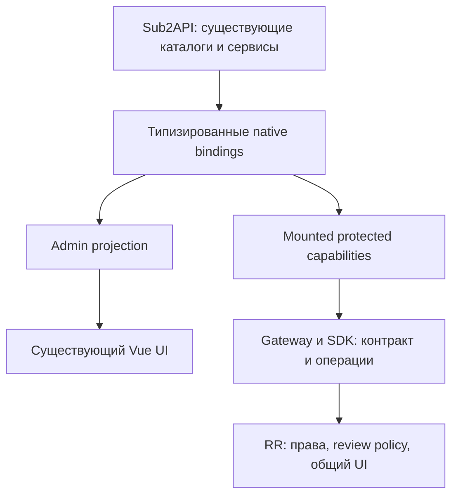

# Полное подключение провайдеров через Sub2API: план и границы

Статус: проект плана, версия 2 после первого круга критики; реализация не начата. Дата: 2026-11-21.
Владелец реализации провайдеров: `agent-teams-ai/sub2api-standalone`.
Потребители: `agent-teams-ai/account-gateway`, `777genius/review-router-ai`.

## 1. Цель и измеримый результат

Sub2API — единственный владелец поддерживаемых провайдеров, продуктов,
способов подключения, обработки credentials, provider HTTP, refresh,
протокольных адаптеров, фактов аккаунта, квот и состояния аккаунта.
Gateway предоставляет безопасный версионированный контракт, identity,
операции и fences. RR применяет права, sharing, политику review и общий UI.

Результат этой работы — полный жизненный цикл подключения для зафиксированного
ниже набора методов существующего Sub2API, а не только добавленные кнопки.
Включены create, reconnect/replace, cancellation/recovery, refresh где он
предусмотрен источником, факты аккаунта, выбор допустимой модели и реальный
review через наши компоненты с контролируемым upstream без платных подписок.

Ключевой архитектурный критерий: новый native provider/product или method ID
на уже поддержанных interaction/protocol primitives вводится в Sub2API,
квалифицируется и появляется в Gateway/RR без provider-specific правок их
исходного кода. Настройка разрешённых профилей deployment/tenant при этом
остаётся возможной. Новый interaction primitive или публичный execution
protocol требует отдельного совместимого обновления контракта и общего UI.

## 2. Зафиксированная исходная точка

| Репозиторий | Проверенный main |
| --- | --- |
| Sub2API Standalone | `2d5f681a627aa1410d08a6d2e568c86f47fca449` |
| Account Gateway | `44bf7ae0c842ef1162779ebe0b05be472e182986` |
| Review Router | `9c52c250b279f81470703b35fae0e787880a08ea` |

Этот план продолжает, но не переписывает историю предыдущей ограниченной
[волны M1/M2](https://github.com/agent-teams-ai/account-gateway/blob/44bf7ae0c842ef1162779ebe0b05be472e182986/docs/reference/native-account-integration-plan.md).
Успешные старые E2E относятся к прежней матрице; они не являются доказательством
перечисленных здесь новых методов. Старый репозиторий `agent-teams-ai/sub2api`
не используется для новых PR.

Проверенные основания для переиспользования:

- [domain.Platforms](../backend/internal/domain/platforms.go),
  [providerProfiles](../backend/internal/service/provider_profile.go) и
  [BuildPlatformCatalog](../backend/internal/service/platform_catalog.go)
  уже владеют платформами, API-key режимами, endpoints и генерацией frontend-каталога.
- [Protected capabilities](../backend/internal/service/native_gateway_account_capabilities.go)
  пока отдельно перечисляют профили и методы, а bootstrap/transport повторяют
  часть этих списков.
- [Gateway public v2](https://github.com/agent-teams-ai/account-gateway/blob/44bf7ae0c842ef1162779ebe0b05be472e182986/packages/account-gateway/src/features/facade-client/contracts/index.ts#L981)
  использует strict objects, закрытый union методов, ограничение в пять методов
  и uniqueness по kind. Несколько OAuth-вариантов не помещаются добавлением поля.
- [RR policy](https://github.com/777genius/review-router-ai/blob/9c52c250b279f81470703b35fae0e787880a08ea/apps/web/src/server/account-gateway-accounts.ts#L1260)
  явно закрывает centralized Claude enrollment/reconnect; это продуктовое
  правило, которое потребуется заменить согласованной политикой методов.
- [Ownership](../ACCOUNT_GATEWAY_OWNERSHIP.md) и
  [RR ADR-035](https://github.com/777genius/review-router-ai/blob/9c52c250b279f81470703b35fae0e787880a08ea/ai-docs/decisions/035-native-account-metadata.md)
  остаются основой разделения ответственности.

## 3. Точный scope: что значит «полноценно»

Scope фиксируется на указанном native commit. Более позднее upstream-добавление
попадает в отчёт различий; оно не превращается автоматически в бесконечный
scope этой поставки. Совместимость с такими добавлениями — отдельный критерий.

| Семейство | Включённые способы и режимы |
| --- | --- |
| Anthropic / Claude | API key; browser/manual-code OAuth; cookie/sessionKey-assisted OAuth; inference-scope setup-token через code/cookie; Bedrock SigV4 с optional session token; Bedrock API key; Vertex service-account JSON |
| Gemini / Google | API key; Google One, Code Assist и custom-client AI Studio OAuth; Vertex service-account JSON; Gemini Vertex API key, включая native express/projectless вариант где он поддержан |
| OpenAI / Codex | Сохранить browser/device/refresh-token/auth.json; добавить direct API key, mobile RT, Codex session import, Agent Identity и PAT по фактическим native handlers |
| Grok | Сохранить browser OAuth; добавить API key, refresh-token import, SSO import |
| Antigravity | OAuth, refresh-token import и native upstream API-key путь с заранее разрешённой целью подключения |
| Kimi, GLM, MiniMax | Сохранить coding/M-plan, добавить доступные PAYG-режимы; не потерять GLM organization/project inputs |
| DeepSeek, OpenCode Go/Zen, TypeSafe, CommandCode, Cline | Native API-key способы и их реальные product/protocol semantics |
| MiMo, OpenRouter, NVIDIA | Сохранить все существующие protected profiles, model policy и ограничения; не потерять их из-за несовпадения с 13 platform IDs админки |

Источники инвентаря: [CreateAccountModal](../frontend/src/components/account/CreateAccountModal.vue),
[реальная ReAuthAccountModal](../frontend/src/components/admin/account/ReAuthAccountModal.vue),
соответствующие handlers/services и существующие protected profiles. Скрытые
access-token/session-token/password переключатели и неиспользуемые обработчики
не считаются доступными методами только из-за наличия в исходниках.

Каждая строка раскрывается в G0 в конкретные `profileId × methodId` и становится
машинно проверяемой матрицей. Для каждого элемента фиксируются:
native handler, create/reconnect support, credential lifecycle, target/product,
execution profile, metadata sources, обязательная конфигурация, tests/evidence.
`Not implemented` или пустой обработчик не закрывают строку матрицы.

### Существенная граница endpoint configuration

Antigravity upstream-key требует base URL. Исключить вообще любые target options
и одновременно обещать все его методы нельзя. Включаем выбор `targetId`,
который разрешён оператором в существующей native/deployment configuration.
Native знает URL, TLS/egress policy и protocol binding; RR передаёт только ID.
То же относится к region/project/organization inputs и существующим MiMo targets.
Target binding задаёт допустимый credential class и доверенные token/refresh/issuer
endpoints. URI внутри service-account JSON не переопределяет эти endpoints;
AWS region не превращается в произвольный hostname. Redirects/proxies/egress
сохраняют существующие ограничения native transport; новый сетевой engine не нужен.

Произвольный URL из пользовательского запроса, пользовательский proxy,
редактирование routing scripts и новый UI управления сетевой политикой
не входят. Default/official targets используют существующие native источники.
Доступность custom-client AI Studio определяется существующей native
конфигурацией, а не создаётся отдельным RR экраном OAuth administration.

### Вне scope

- Перепроектирование pool scheduling, ротации, cooldown/failover, pricing/billing administration,
  bulk import/export и полный перенос админки в RR.
- Новый auth/workflow engine, plugin runtime, DSL, универсальный JSON-Schema
  renderer, новая БД каталога или metadata, отдельный secret vault.
- Переписывание Vue frontend, всех legacy accounts или всей composition системы.
- Новые feature flags, отдельный qualification service, автоматическое включение
  всех upstream платформ и model admission по названию тарифа.
- Новые providers сверх baseline; автоматизация периодической синхронизации
  upstream; массовые dependency/framework/toolchain upgrades.
- Запросы с реальными подписками, production rollout и публичный package release
  без отдельного действующего разрешения. Merge и CI не означают deployed.

## 4. Решение и владельцы знаний

| Знание или состояние | Владелец | Что передаётся потребителю |
| --- | --- | --- |
| Provider/product/method ID, параметры и доступные inputs | Sub2API | Безопасный descriptor |
| Credentials, token exchange, refresh, provider HTTP/codecs | Sub2API | Write-only ingress; safe receipt и результаты |
| Настоящие email/plan/dates/provenance | Sub2API | AccountInfo; без второго durable store |
| Models, quotas, health/cooldown | Существующие native owners | Существующие отдельные contracts |
| Logical accountRef/ownerRef, operation journal, idempotency/fences | Gateway | Public SDK operations |
| Membership, sharing, binding visibility, review/run policy | RR | Разрешённая viewer-проекция |
| Renderer kinds и поддерживаемый public execution protocol | Consumer/SDK | Проверка совместимости, не список вендоров |

### 4.1 Native bindings вместо нового мегареестра

Расширяем существующие `domain.Platforms`/`providerProfiles` и добавляем небольшие
connection declarations, которые ссылаются на реальный lifecycle adapter,
metadata collector и execution adapter. Это обычные Go types/functions и
composition-time references, а не исполняемый внешний манифест.

Выносим повторное перечисление mounted profiles в один список native bindings.
Переиспользуем существующие `QualificationRef`, resource bounds, custody,
generation/owner fences и transport lifecycle. Старые config fields переводим
в этот список через временную совместимую проекцию; не меняем все deployments
одновременно и не допускаем выбора произвольного adapter из пользовательского JSON.

В native остаются необходимые provider-specific ветви HTTP/claims/codecs.
DRY означает одного владельца правила, а не запрет специализированного кода.

### 4.2 Две проекции одного источника

1. Admin inventory: реализованные платформы, продукты и методы, включая
   условные требования конфигурации.
2. Protected capabilities: только реально mounted и квалифицированные bindings
   с custody, lifecycle, dispatch и нужной конфигурацией.

Это две проекции, не два редактируемых каталога. Список evidence привязан к
native binding и contract revision; он не становится ещё одной таблицей
провайдеров, которую нужно вручную синхронизировать в RR.

Создание аккаунта, возможность reconnect, выполнение review и наличие metadata
описываются отдельно. Метод может быть недоступен для нового подключения,
пока уже существующий аккаунт остаётся пригодным для выполнения.

### 4.3 Public v3 с тремя типами взаимодействий

Расширяем существующий SDK отдельным `provider-connections/v3` и версионированным
ingress, так как текущая строгая v2 не допускает нового shape. Native private
`native-account-capabilities/v1` — другой контракт; его версия обновляется
отдельно, согласованно с private adapter, без смешения номеров с public API.

Открытые стабильные ID: provider, product, profile, method, region/target.
Закрытые исполняемые primitives:

| Interaction | Поведение общего UI |
| --- | --- |
| Browser authorization | Открыть выданный native URL; automatic callback или ограниченный ввод code/callback URL |
| Device authorization | Показать verification URL/code/expiry и статус существующей операции |
| Credential form | Передать bounded text/secret/select/document fields в существующий sensitive ingress |

Любой method может иметь один необязательный предварительный набор полей из
той же vocabulary. Для browser/device project/organization/tier context
проверяется native при begin и связывается с intent до выдачи challenge.
Затем выполняется фиксированный browser/device flow. Это покрывает Google
Code Assist/Antigravity без provider-specific формы и без workflow DSL.
Исправление ошибочного project не даёт права повторно использовать уже
потреблённый authorization code.

API key, cookie, service-account JSON, AWS credentials и импорты — разные
method IDs и простые декларации полей. Bedrock SigV4/API key и Vertex
service-account/API key — отдельные методы, а не `if/then` язык форм.

Descriptor содержит identity, semantic method revision, create/reconnect support,
availability/reason, field IDs/types/limits/static choices и необходимые
compatibility и custody/security requirements. Небольшой закрытый набор
credential policy classes задаёт native adapter, не пользователь: обычный
provider key, subscription/session credential, cloud identity и delegated
identity не становятся одинаковыми полномочиями из-за общей формы.
Минимальный набор классов и requirements фиксируется в G0. Сервер повторно
проверяет их перед sensitive ingress; неизвестный required class запрещает метод.
Descriptor не содержит JS, HTML, arbitrary regex,
submission endpoints, scripts или произвольный граф переходов. Названия и
подсказки — bounded plain text; неизвестный бренд имеет нейтральный icon fallback.

Сначала consumer проверяет bounded envelope и requirements. Известный метод
строго валидируется по своему primitive. Неизвестный required kind/requirement
отключает конкретный метод с `client_upgrade_required`, а не превращается в
API key и не ломает весь известный каталог. Повреждённые известные поля не
принимаются через глобальное ослабление validation.

Provider identity остаётся открытой, но RR execution engine enum не становится
произвольным: native profile сопоставляется с уже поддержанным protocol adapter.
Labels/brand assets не определяют backend, auth, модель или тариф.

UX использует provider → product, если их несколько → method; ownership
выбирается один раз через существующий personal/workspace flow. Технические
profile IDs не становятся названиями кнопок. Reconnect сохраняет product,
region/project и явно показывает смену цели. Native возвращает безопасные
field-level error codes по field IDs, без submitted values и raw provider errors.
Все введённые значения считаются sensitive по умолчанию, независимо от типа
renderer; только явно разрешённый безопасный context попадает в safe DTO.

### 4.4 Совместимость и завершение текущих операций

- Public v1/v2 остаются вычисляемыми проекциями того же snapshot. Выводятся
  только методы, которые можно представить без изменения старой семантики.
- Fallback на старую версию разрешён только по явному version negotiation;
  auth error, invalid payload, timeout или 500 не трактуются как старый сервер.
- Новая операция связывается с owner/profile/method и semantic input revision.
  Общий catalog revision/ETag используется для чтения и diff, не как identity
  операции: добавление другого провайдера не ломает pending connect.
- Existing native intent захватывает применимый binding/config generation
  или существующее эквивалентное неизменное разрешение. Смена URL, client/scopes
  за тем же target ID не переинтерпретирует ранее принятые inputs/callback.
  Method revision меняется при input/target/security semantics, не при labels,
  порядке методов или model freshness. Глобальный config revision для этого не нужен.
- Input/connect deadline запрещает новый entry, но не снимает уже принятый
  внешний эффект или unresolved claim. Старые decoders, захваченный binding
  и readback/reconciliation сохраняются по existing journal policy до штатного
  разрешения операции. Если конфигурация отозвана, эффект не воспроизводится
  под новой; остаётся безопасный unresolved/readback outcome. Restart разрешён
  только при доказанном отсутствии effect entry, не после entered/unknown.
- Не переименовываем существующие profile/account IDs и не пересоздаём аккаунты.
  Native legacy config adapter имеет native-владельца и удаляется после миграции
  deployment configs. Public v1/v2 projections принадлежат Gateway и остаются
  в этой поставке; их последующее удаление — отдельная version migration после
  окончания поддержки клиентов и разрешения старых operations, не только TTL.
- Исчезновение метода из discovery не удаляет аккаунт. Независимые native
  authorization/revocation и execution admission продолжают действовать.

### 4.5 Product policy без shadow provider catalog

Итоговая доступность — пересечение native capability, deployment policy,
consumer protocol/renderer/custody support и tenant/product authorization. Списки
разрешённых profile IDs в deployment policy могут быть узкими, но не содержат
копий provider endpoints, методов, labels, models или правил refresh.

Существующее Claude centralized-deny меняется только для квалифицированных
методов с теми же гарантиями custody/identity/review. Это явное изменение
продуктового поведения данной волны; существующий Secret/CLI путь сохраняется.
Новые feature flags не вводятся: используются существующие permissions и
immutable compatibility checks.

Расширение connection catalog не расширяет model admission. Сохраняются
account-scoped native models, квалифицированные anchors, разрешённые
protocol/tools/reasoning/fast controls, product/project scopes и native
health/rate-limit/cooldown. Каждый новый профиль ссылается на существующего
native владельца этих правил. Общий provider label, `/models` или выбранный
пользователем tier не дают дополнительных полномочий или моделей сами по себе.

### 4.6 Все затронутые consumer seams, а не только Connections

Общий переход охватывает SDK model discovery/source dispatch, RR provider setup
и model picker, personal-operation recovery, account limits и usage attribution.
В baseline это, в частности, `accountModelDiscoveryProfiles` в SDK и RR
`setup-provider.ts`, `personal-account-composition.ts`,
`account-limits-composition.ts`, `gateway-profile-provider.ts`.
Перечисления providers/profiles заменяются чтением применимой capability;
существующие models/limits/usage contracts и правила авторизации сохраняются.

Usage классифицируется по native profile/product и существующему usage contract,
не по бренду и не по отображаемому plan label. Добавление PAYG не должно менять
учёт уже существующего coding-аккаунта того же Kimi/GLM/MiniMax. Это bounded
исправление адаптеров, не новая billing system. Из крупного RR controls-файла
извлекаются только затронутые формы/адаптеры с соблюдением repository line ceilings.

## 5. Credentials, identity и отсутствие дублей

Сохраняем существующий durable operation engine, CAS/fences, same-secret claim
там, где обмен одноразовый/rotating, ambiguous-result recovery и native custody.
Новые методы реализуют его существующие ports; второй lifecycle store не нужен.

Ввод может транзитно проходить browser → RR → SDK → Gateway → native через
существующий sensitive ingress. Обещание «секрет никогда не бывает в RR/SDK»
было бы неверным. Инвариант: нет durable credentials в RR/Gateway, обычных
read DTO, capability catalog, logs/traces, analytics и browser persistence.
Полные provider token responses, долговременное хранение и refresh остаются native.
OAuth callback/code/credential semantic parsing также выполняется native.

Общий ingress ограничивает размер, разрешённые field IDs, transport encoding,
operation authority и число запросов; native валидирует формат и binding
провайдера. Несекретные project/organization/region/target также связываются
с intent и проверяются native. AccountInfo read выполняет только bounded local
authorization/snapshot reads: без provider HTTP, token refresh и мутаций.
Collectors работают в существующих auth/refresh/quota/maintenance путях;
административное обновление или изменение настройки остаётся отдельной операцией.

Одно исполнение operation ID даёт один логический результат; повторный ответ
и reconnect не создают дубль. Не вводим универсальное слияние аккаунтов по
email или API key: personal/workspace, project/region и разные продукты могут
законно отличаться. Когда provider не позволяет доказать identity, показываем
ограничение и применяем существующее правило замены credentials владельцем.

Одна операция импорта относится к одному логическому аккаунту. Форматы
Codex session/Agent Identity/RT принимаются в одиночном варианте; многозаписный
payload отклоняется до side effects. Не выбираем молча первую запись, не
исполняем часть batch и не наследуем admin `update_existing` без owner-scoped
authority. Это полнота способов подключения одного аккаунта, а не bulk UI parity.

## 6. Общие metadata sources вместо расхождения admin и protected

Сохраняем текущий bounded AccountInfo и envelope состояний
`known/unknown/unsupported/unavailable`, source/observedAt и freshness/stale.
Не создаём произвольную facts schema, новый refresh scheduler или RR facts DB.

| Подтверждённое расхождение | Изменение внутри native |
| --- | --- |
| Privacy known сейчас отвергается новым producer policy, хотя admin хранит результат | Общий доверенный collector/observation и bounded projection |
| Admin использует `/subscriptions` fallback для expiry, защищённый путь — нет | Один helper определения даты для обоих путей с текущими identity/timeout bounds |
| Grok tier использует факты и эвристику по quota | Один resolver с происхождением; inferred не выдаётся за provider-confirmed |
| Gemini tier fallback задаётся пользователем | Declared input не становится verified subscription fact |

`privacyMode` сохраняется как совместимое wire-имя, но означает только
подтверждённую настройку использования данных для обучения. Общий UI пишет
«Использование данных для обучения: включено/отключено», не «полностью Private».
Ошибка PATCH/Cloudflare — результат операции, не доказательство public.
Старое raw `extra` без producer/time/identity evidence не повышается до known.
Для провайдера с иной privacy semantics не придумываем эквивалентность.

Общие collectors сохраняют source ordering: order резервируется до HTTP,
запись проверяет physical identity, selected principal, generation и credential
revision. Полное авторитетное omission снимает старое значение; partial response
или timeout этого не делают. Plan и expiry принадлежат одному account/scope.
Поздний ответ старого credential не возвращает отозванный факт. Optional metadata
пишется через существующий private savepoint и не теряет успешно ротированный
refresh token; owner/identity/attempt проверки остаются обязательными.
Одновременно обновляются bounded source policy, priority и capacity: текущая
реализация ограничивает sources четырьмя и запрещает privacy known.

Для каждого важного admin-поля матрица указывает shared native source либо
конкретную причину, почему достоверного значения нет. `Unsupported` не может
маскировать забытый доступный producer. Разделяем subscription expiry,
credential expiry и локальное administrative account expiry.

Project/region/auth method — несекретный connection context. Models, quota,
health/cooldown остаются в существующих contracts. AccountInfo не становится
мега-объектом, а plan label не управляет admission.

Admin UI получает те же нормализованные факты через admin projection, сохраняя
свои операционные кнопки/диагностику. Затрагиваем только общие extractors,
выбор методов и относящиеся к ним metadata presentation; modal целиком не переписываем.
RR сохраняет final live authorization и одинаковую проекцию personal,
workspace, overview и выбранного аккаунта.

## 7. Как поддерживать изменения Sub2API

| Тип upstream-изменения | Где меняется production code |
| --- | --- |
| Новый provider/product на известных primitives | Native registration/adapter и qualification; consumer code не меняется |
| Новый method ID на известных fields/browser/device | Native method binding и tests; consumer code не меняется |
| Изменились endpoint/token refresh/metadata semantics | Native service и его tests |
| Новый interaction primitive или execution protocol | Versioned shared contract и соответствующий общий renderer/adapter |
| Изменился label/список допустимых вариантов | Native source и generated projection |
| Метод удалён/изменил существенную семантику | Native compatibility/retirement с method revision и управляемым завершением операций |

В existing upstream-sync/qualification workflow добавляем bounded export/diff
инвентаря и contract checks. Отчёт показывает добавленные/удалённые/изменённые
methods, products, required inputs, requirements и semantic revisions. Новые возможности не
прячутся молча за старым списком RR и не включаются только по факту merge upstream.
Изменение кода источника без изменения declaration не обнаруживается одним
JSON diff: его покрывают профильные regression tests и ревью native paths.

Категории методов admin UI переводятся на native-generated declarations.
Проверка реальной формы сравнивает отображаемые/вызываемые методы с декларацией,
на baseline matrix и conditional configurations. Не сканируем строки Vue
через grep и не генерируем expected исключительно из той же функции, что actual.
Для Go/TS boundaries используем одни wire examples и cross-language conformance;
новый schema compiler/codegen framework не нужен.

Обновление фиксируется в воспроизводимом наборе source commits/SDK artifact.
Qualification ledger содержит evidence, не отдельные provider facts.
Новая cron automation для синхронизации в этой работе не создаётся.

## 8. Порядок реализации и PR

Каждый implementation PR начинается Draft. Коммиты публикуются сразу;
незакоммиченные/непушенные цепочки не накапливаются. Требования author/committer
каждого репозитория и существующие toolchain pins соблюдаются. TypeScript не ниже
7.0.2, без отката на 5.9; отдельного toolchain upgrade в scope нет.

| Этап | Результат | Условие выхода |
| --- | --- | --- |
| G0: inventory и contract | Конкретная baseline матрица, wire v3 examples, input/recovery semantics; source trace Agent Identity/PAT, Antigravity, Google/cloud и TypeSafe; один bounded spike только для остающегося спорного пути | Все рисковые семейства представимы выбранными primitives; минимальный RR review contract определён; пересчитана оценка |
| G1: native declarations/bindings | Канонические методы, две проекции, generic mounted list, совместимость старого config | Native projections и новый test-only binding проверены; все старые mounted профили проходят прежние gates |
| G2: Gateway/SDK/RR foundation | v3, ingress, primitives, setup/models/limits/usage/recovery seams, product policy, compatibility | Реальный новый test-only native provider/method проходит UI, create/reconnect, model selection, review и usage на неизменном consumer build |
| G3: metadata parity | Общие collectors/admin projection и исправленные privacy/expiry/Grok/Google facts | Значения и их происхождение согласованы; privacy/visibility/revoke tests проходят |
| G4: Anthropic/Gemini | Все перечисленные OAuth/import/cloud методы | Native method matrix и reviews соответствующих execution profiles проходят |
| G5: остальной baseline | OpenAI/Grok/Antigravity и оставшиеся API-key products | Каждая baseline строка закрыта или явно отмечена как незавершённая; отсутствие реализации не считается готовностью |
| G6: финальная интеграция | Удалены заменённые consumer allowlists/parsers, drift/upgrade checks, visual E2E, evidence | Полная выбранная матрица, compatibility и source-bound CI; review замечания устранены |

G3 и native adapters G4/G5 можно вести параллельно после G0, на одном зафиксированном
контракте. Общие schema/registry/migration файлы имеют одного интегратора;
для независимых правок используются отдельные worktrees. Работа не требует
одного гигантского PR: foundation и затем семейства поставляются отдельными
сквозными срезами, не добавляя заглушек за feature flags.

Последовательность зависимых merge: native → Gateway → RR с квалифицированным
packed SDK. Для реализации создаются/обновляются применимые deployment records;
этот план не разрешает production cutover или ручной public release.
Legacy v1/v2 projection имеет владельца и критерий удаления; она не развивается
как второй каталог. Не поднимаем временную совместимость до бессрочной архитектуры.

## 9. Проверка end-to-end без реальных подписок

### 9.1 Матрица по разным осям, без полного декартова произведения

1. **Все profile × method:** packed SDK → реальный Gateway → native service +
   PostgreSQL + controlled OAuth/provider endpoints, policy/ingress/readback,
   create/receipt, reconnect и refresh где применимо.
   Матрица проверяет также каждый объявленный input/target/product и conditional
   configuration. Для AI Studio/targets проверяются и unavailable без config,
   и полный lifecycle с тестовой config. Контрактный unit test не заменяет это исполнение.
2. **Каждый execution profile и auth family:** настоящий joined путь
   native → Gateway → packed SDK → RR review, streaming/function tool roundtrip,
   continuation и завершённый review result. Дополнительные методы имеют отдельный
   joined case там, где меняются token scope, endpoint, project или dispatch.
   Fixture следует фактическому native wire, не приписывает ему несуществующие
   tools/continuation. Если профиль не выполняет минимальный RR review contract,
   он остаётся незавершённым для review; один successful connect недостаточен.
3. **Каждый UI primitive:** реальные browser submissions, reconnect/cancel,
   очистка secrets при закрытии/смене метода, понятные unavailable/upgrade причины,
   owner/shared/borrower visibility. Разные provider labels не размножают один UI test.
4. **Совместимость:** старые v1/v2 потребители, новые consumers со старым native,
   неизвестный provider с известным primitive, неизвестный required kind,
   исчезнувший метод и pending operation при независимом catalog update.

Node 26 выполняет полную semantic matrix; Node 24 — обязательные compatibility
представители и существующие required lanes. Не дублируем каждую комбинацию
на двух Node версиях без отдельного риска или repository gate.

### 9.2 Независимые негативные проверки

Существующие harness и durable journal используются для replay после потерянного
ответа, rotating token ambiguity, cancel/expiry, owner transfer/revoke,
concurrent reconnect, foreign profile/target, invalid input/unknown fields,
upstream timeout/429/refresh failure и restart. Sentinel credentials проверяются
на отсутствие в durable consumer DB, logs/readback/artifacts. Не ослабляются
timeouts/retries ради зелёного CI.

Проверка расширяемости: test-only native provider и новый метод на известных
primitives появляются в настоящем RR setup, подключаются, выбираются для review,
получают account models, выполняют review, корректно отражают usage/limits и
восстанавливают pending operation без production правок consumer-кода.
Consumer checkout/build должен быть тем же; одних
изменённых test fixtures или сериализации descriptor недостаточно.

Регрессии native semantics включают отклонение запрещённой модели/tool,
routing-by-model для соответствующих платформ, mixed PAYG+coding одного vendor
и ClinePass wallet cooldown без скрытой смены выбранного платёжного режима.

### 9.3 Что означает PASS

Контролируемый upstream подтверждает wiring, custody/fences, protocol translation,
refresh/recovery и UI. Он не доказывает, что реальная подписка провайдера примет
запрос, не обходит внешние проверки доступа и не считается production observation.
Live-provider acceptance остаётся явно `not run — excluded by user constraint`.
Queued/running/skipped не считаются успешным исполнением. Ошибки доступного
кода исправляются; очередь CI ожидается штатно без restart loops.

## 10. Оценка объёма и рисков

Диапазоны относятся к дополнительной работе после baseline. Это новые или
существенно изменяемые рукописные строки, не обещание точного diff и не цель
по количеству кода. Перенос существующих строк не считается новой логикой.
Generated outputs, lockfiles, docs и релизная координация исключены.

| Пакет без двойного счёта | Production LOC | Tests/fixtures/verification LOC |
| --- | ---: | ---: |
| Native declarations, projections, mounted bindings | 900–1 600 | 600–1 000 |
| Gateway/SDK/RR общая основа, все consumer seams и совместимость | 2 400–4 200 | 2 000–3 400 |
| Общие metadata sources и полная baseline проекция | 900–1 700 | 1 200–2 400 |
| Anthropic/Gemini native adapters, Bedrock/Vertex | 2 200–3 700 | 2 500–4 200 |
| Остальные baseline методы и execution adapters | 1 600–3 000 | 1 800–3 200 |
| Узкое выравнивание admin choices и удаление заменённого кода | 250–650 | 250–450 |
| Общая joined E2E/upgrade/drift оснастка, без provider fixtures выше | 0 | 800–1 400 |
| **Итого** | **8 250–14 850** | **9 150–16 050** |

Предыдущие 4 100–6 800 production относились только к Anthropic/Gemini и не
прибавляются к этой таблице. Прежние 350–700 строк privacy/expiry входят в
metadata строку. Native/Gateway/RR разрезы — альтернативная группировка,
а не дополнительные суммы. После G0 и первого joined slice оценка обновляется.

Правила учёта: native foundation считает Go declarations/export, admin alignment
— только Vue method choices/cleanup. Metadata включает collectors и относящееся
к ним presentation. Consumer tests считают schemas/SDK compatibility/ingress/
policy/renderer/clearing, provider rows — специфические auth/protocol fixtures.
Последняя строка — process/build/provisioning orchestration, same-build proof,
inventory drift и финальный scan artifacts; совместимость SDK не считается второй раз.

- Сложность основы: 7/10; полного baseline: 9/10.
- Уверенность в архитектурном направлении: 8/10; в LOC до spikes: 6/10.
- Целевой уровень надёжности: 9/10 при выполнении раздела 9; это не оценка
  уже достигнутой runtime reliability. План сам по себе E2E не заменяет.

Главные неопределённости: Agent Identity/PAT semantics, Antigravity target,
Gemini OAuth dispatch/refresh и TypeSafe protocol differences. G0 должен
проверить их до параллельного массового написания adapters. Если один метод
требует нового primitive, пересматривается именно его slice, а не строится
универсальный framework на все будущие способы авторизации.

## 11. Критические проверки плана

Версия 1 подготовлена после трёх независимых исходных разборов: native ownership,
consumer evolution/UX и credentials/metadata/E2E. Затем выполнен первый круг
критики общего документа тремя reviewers. В версии 2 исправлено:

- Добавлены preflight fields для browser/device, single-account граница импортов,
  security classes отдельно от renderer и конкретный безопасный UX.
- Расширен bounded consumer scope на models/setup/limits/usage/recovery;
  добавлена mixed PAYG/coding регрессия. Пересчитан foundation budget.
- Intent связывается с per-binding config generation; expiry не обнуляет
  unresolved effects, restart допускается только до effect entry.
- AccountInfo read запрещает весь provider I/O; сохранены source ordering,
  omission, credential fences и optional-metadata rotation savepoint.
- Уточнены trusted endpoints, все-method SDK/Gateway ingress, conditional
  configuration и минимальный фактический review protocol.
- Исправлена зависимость G1/G2, сохранены native model/admission/cooldown rules,
  снято ложное обещание выявлять любое semantic изменение одним inventory diff.
- Из общего harness убран повторно посчитанный SDK compatibility бюджет.

Второй круг проверяет эту версию на конкретных сценариях обновления и отказа.

Уже отклонённые варианты:

| Вариант | Причина |
| --- | --- |
| Дописывать provider switches во всех репозиториях | Сохраняет стоимость каждой новой интеграции и рассинхронизацию |
| Проксировать admin API в RR | Нарушает custody/operation guarantees и выдаёт raw token responses |
| Универсальный JSON-schema/workflow/plugin framework | Увеличивает исполняемую поверхность и сложность без текущей необходимости |
| Автоматически включать все platform IDs | Inventory не доказывает protected lifecycle или review compatibility |
| Заменить все каталоги одним новым мегакаталогом | Дублирует существующих native владельцев вместо их переиспользования |

## 12. Итоговые критерии приёмки

1. Каждый baseline provider/product/method имеет native handler, параметры,
   lifecycle и source-bound evidence; условные требования конфигурации видимы.
2. Новый provider/method на известных primitives проходит полный путь без
   provider-specific правок Gateway/RR. Неизвестный primitive не ломает известные.
3. Admin и protected используют общие native факты и method declarations;
   drift выявляется проверкой, а не последующим ручным сравнением скриншотов.
4. Credentials остаются write-only; ownership, replay, cancellation, reconnect
   и ambiguity сохраняют существующие гарантии. Нет нового operations/facts store.
5. Privacy/expiry и остальные важные metadata sources сопоставлены с admin;
   unknown/declared/inferred не выдаются за подтверждённые данные.
6. Все выбранные native method executions, joined review profiles, browser
   primitives и compatibility checks реально выполнены; skipped не заменяет PASS.
7. Связанные PR слиты в порядке зависимостей, финальные checks зелёные,
   SDK/source pins и оставшиеся rollout requirements отражены в документации.
8. Реальные подписки и production deployment не заявлены проверенными.

Этот документ — план реализации и критерии её завершения, не отчёт о готовой
функциональности. Закрытие только foundation или части провайдеров не закрывает
всю зафиксированную цель.
